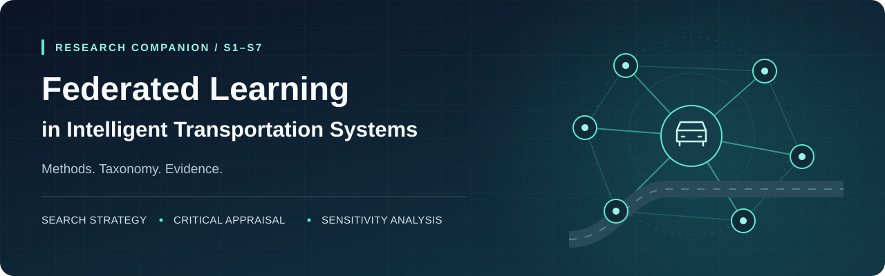

<p align="center">
  
</p>

<h1 align="center">FL–ITS Review · Supplementary Materials</h1>

<p align="center">
  Search methods, taxonomy, appraisal, and sensitivity analysis<br>
  for research on federated learning in intelligent transportation systems.
</p>

<p align="center">
  <a href="#supplement-library"></a>
  <a href="#supplement-library"></a>
  <a href="https://github.com/mahbubchula/fl-its-review-supplements/releases/tag/v1.0.0"></a>
</p>

<p align="center">
  <a href="#supplement-library"><b>Browse supplements</b></a> &nbsp;·&nbsp;
  <a href="https://github.com/mahbubchula/fl-its-review-supplements/releases/download/v1.0.0/FL_ITS_Supplementary_Materials_v1.0.0.zip"><b>Download v1.0.0 ZIP</b></a> &nbsp;·&nbsp;
  <a href="#citation--manuscript-use"><b>Citation &amp; manuscript use</b></a>
</p>

---

## About the review

These materials accompany the manuscript:

> **The Role of Federated Learning in Intelligent Transportation Systems: Taxonomy, Emerging Trends, Applications, Open Challenges, and Future Research Directions**

The seven supplements document how the review corpus was assembled, classified, and appraised. They provide the search expressions, corpus summaries, coding framework, reviewer agreement, detailed appraisal criteria, and comparisons of alternative search boundaries.

| Review corpus | Publication window | Taxonomy dimensions | Detailed appraisal |
| :---: | :---: | :---: | :---: |
| **691 publications** | **2020–2025** | **5 dimensions** | **31 entries** |

*Figures above are reported in S2, S3, and S5. Scope, assumptions, and methodological qualifications are described in the individual supplements.*

## Supplement library

The links below download the **current documents on `main`**.

| ID | Supplement | What you will find | Download |
| :---: | :--- | :--- | :---: |
| **S1** | **Search strategy & study selection** | Database search expressions, eligibility criteria, and screening flow. | [Word ↗](https://github.com/mahbubchula/fl-its-review-supplements/raw/refs/heads/main/S1_Search_Strategy.docx) |
| **S2** | **Corpus characteristics** | Bibliographic characteristics and annual publication output. | [Word ↗](https://github.com/mahbubchula/fl-its-review-supplements/raw/refs/heads/main/S2_Corpus_Metadata.docx) |
| **S3** | **Taxonomy & coding framework** | Architecture, aggregation, privacy, heterogeneity, and transportation application categories. | [Word ↗](https://github.com/mahbubchula/fl-its-review-supplements/raw/refs/heads/main/S3_Taxonomy_Codebook.docx) |
| **S4** | **Coding reliability** | Reviewer classifications and agreement estimates for 60 dual-coded records. | [Word ↗](https://github.com/mahbubchula/fl-its-review-supplements/raw/refs/heads/main/S4_Coding_Reliability.docx) |
| **S5** | **Selection for detailed appraisal** | Six selection criteria and the distribution of 31 entries across six research strands. | [Word ↗](https://github.com/mahbubchula/fl-its-review-supplements/raw/refs/heads/main/S5_Study_Selection.docx) |
| **S6** | **Critical appraisal & study coding** | Four appraisal dimensions and the study coding matrix. | [Word ↗](https://github.com/mahbubchula/fl-its-review-supplements/raw/refs/heads/main/S6_Critical_Appraisal.docx) |
| **S7** | **Search-boundary sensitivity** | The effects of energy-related exclusions and including conference proceedings. | [Word ↗](https://github.com/mahbubchula/fl-its-review-supplements/raw/refs/heads/main/S7_Sensitivity_Analysis.docx) |

## Where to start

- **Understand the search and corpus:** read S1 → S2.
- **Explore the classification and its reliability:** read S3 → S4.
- **Follow the detailed appraisal:** read S5 → S6.
- **Examine the coverage boundaries:** read S7.

## Downloads & versions

| Your purpose | Recommended source |
| :--- | :--- |
| Read the latest supplements | Individual downloads in the [supplement library](#supplement-library). |
| Download the archived set together | [v1.0.0 ZIP archive](https://github.com/mahbubchula/fl-its-review-supplements/releases/download/v1.0.0/FL_ITS_Supplementary_Materials_v1.0.0.zip). |
| Cite a fixed version | [v1.0.0 release](https://github.com/mahbubchula/fl-its-review-supplements/releases/tag/v1.0.0) and its release assets. |
| Verify current document integrity | [SHA256SUMS.txt](SHA256SUMS.txt). |

> [!NOTE]
> The archived **v1.0.0** release preserves its original files. The current `main` branch includes the updated S1 search strategy document and its checksum, so it differs from that release. Use the checksums supplied with the version you download.

<details>
<summary><b>Verify the downloaded documents</b></summary>

Download the seven Word documents and the matching `SHA256SUMS.txt` into the same folder, then run:

**macOS**

```sh
shasum -a 256 -c SHA256SUMS.txt
```

**Linux**

```sh
sha256sum -c SHA256SUMS.txt
```

Each document should return `OK`.

</details>

## Citation & manuscript use

Please cite the **main manuscript** when referring to its findings. When citing these supplementary materials, include the versioned release link so readers can retrieve the same files.

Citation metadata for the archived release is available in [CITATION.cff](CITATION.cff).

**Suggested availability statement for v1.0.0**

> Supplementary Materials S1–S7 are publicly available in the GitHub repository at https://github.com/mahbubchula/fl-its-review-supplements/releases/tag/v1.0.0.

This statement refers to the archived release. If you use the updated documents on `main`, identify the specific commit in your availability statement.

## Authors

**Mahbub Hassan** · **Sumon Chandra Ray** · **Md Kamrul Islam** · **M. M. Hafizur Rahman**

---

<p align="center">
  <sub>Federated learning · Intelligent transportation systems · Supplementary research materials</sub><br>
  <a href="#"><b>Back to top ↑</b></a>
</p>
